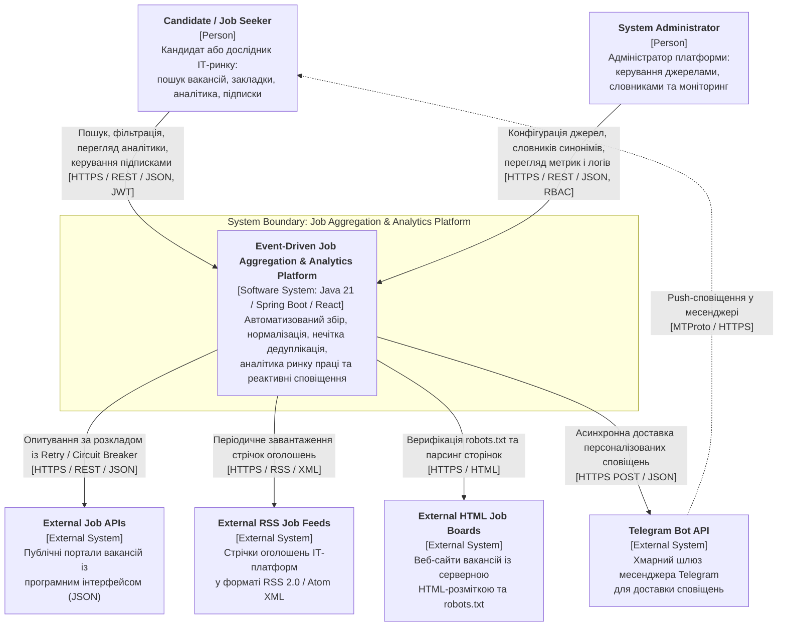
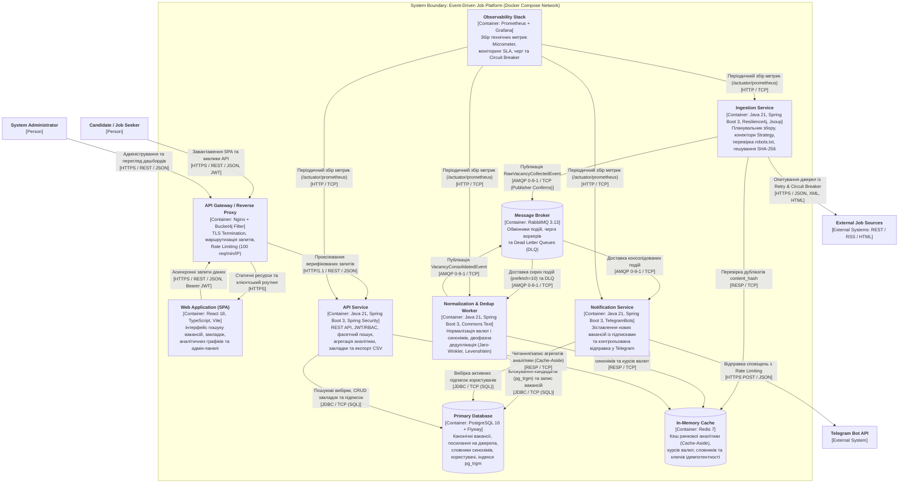
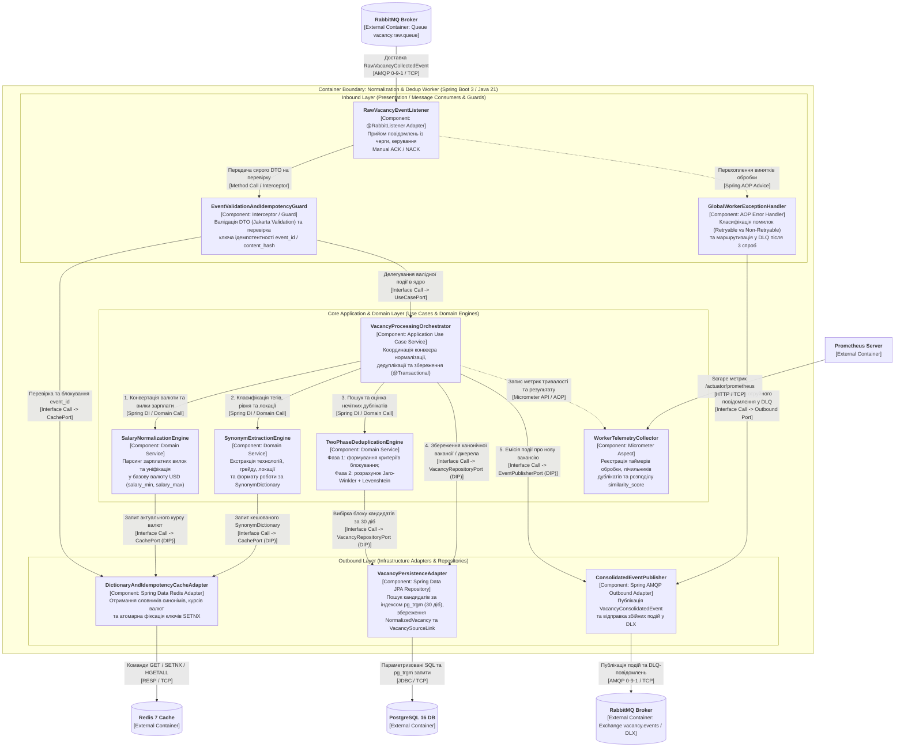

# РОЗДІЛ 2. ПРОЄКТУВАННЯ СИСТЕМИ

> Статус: в роботі / виконано базове архітектурне моделювання (етапи 2–3, 01.11.2026 – 20.12.2026).  
> Пов'язані інженерні артефакти: [Специфікація вимог SRS (ISO/IEC/IEEE 29148)](srs.md) | [ADR-001: Вибір брокера повідомлень RabbitMQ](adr/0001-choice-of-technology.md)

---

## 2.1. Контекстне та контейнерне моделювання системи (C4 Model)

Проєктування архітектури платформи виконано за ієрархічною методологією Саймона Брауна (`C4 Model`) із застосуванням підходу `Diagrams-as-Code` (`Mermaid.js`) та наскрізним трасуванням функціональних і нефункціональних вимог зі специфікації [SRS](srs.md).

### 2.1.1. Контекстна діаграма системи (C4 Level 1: System Context Diagram)

На першому рівні деталізації (`System Context`) платформу подано як цілісну програмну систему в оточенні двох категорій користувачів та чотирьох типів зовнішніх систем.

#### Технічний опис вузлів та протоколів рівня System Context (Трасування до SRS)

1. **Candidate / Job Seeker (`[Person]`):** основний користувач системи, який звертається до платформи за протоколом `HTTPS` (`REST / JSON`) із безстановою автентифікацією `JWT` ([SRS-NFR-SEC-01](srs.md#srs-nfr-sec-01)). Отримує доступ до повнотекстового та фасетного пошуку вакансій ([SRS-FUN-07](srs.md#srs-fun-07)), закладок і статусів відгуків ([SRS-FUN-08](srs.md#srs-fun-08)), а також кешованих дашбордів ринкової аналітики ([SRS-FUN-09](srs.md#srs-fun-09)).
2. **System Administrator (`[Person]`):** привілейований користувач із роллю `ROLE_ADMIN` ([SRS-NFR-SEC-01](srs.md#srs-nfr-sec-01)), який через захищений `HTTPS / REST API` керує параметрами конекторів, довідником синонімів, порогом дедуплікації та контролює журнали помилок і телеметрію ([SRS-FUN-10](srs.md#srs-fun-10)).
3. **External Job APIs / RSS Feeds / HTML Job Boards (`[External Systems]`):** гетерогенні зовнішні постачальники даних про вакансії. Взаємодія здійснюється в режимі ізольованого опитування за протоколом `HTTPS` (`JSON`, `XML`, `HTML`) відповідно до вимог [SRS-FUN-01](srs.md#srs-fun-01), з перевіркою директив `robots.txt` ([SRS-FUN-02](srs.md#srs-fun-02)) та обгортанням викликів у декоратори `Retry` і `Circuit Breaker` ([SRS-NFR-REL-01](srs.md#srs-nfr-rel-01)).
4. **Telegram Bot API (`[External System]`):** зовнішній шлюз доставки, до якого платформа надсилає `HTTPS POST` запити з `JSON`-тілом при виявленні вакансій, релевантних підпискам користувача ([SRS-FUN-10](srs.md#srs-fun-10), [SRS-NFR-PERF-03](srs.md#srs-nfr-perf-03)).

---

### 2.1.2. Контейнерна діаграма системи (C4 Level 2: Container Diagram)

На другому рівні моделі `C4` (`Container Diagram`) розкрито внутрішню топологію розгортання платформи у середовищі `Docker` ([SRS-NFR-MAINT-01](srs.md#srs-nfr-maint-01)), що складається з клієнтського застосунку, вхідного шлюзу, чотирьох спеціалізованих серверних сервісів, реляційної СУБД, In-Memory кешу, брокера повідомлень та контуру спостережуваності.

#### Технічний опис контейнерів та наскрізне трасування вимог

1. **Web Application (`[Container: React 18, TypeScript, Vite]`):** клієнтський односторінковий застосунок (`SPA`), який візуалізує фасетний пошук вакансій, список першоджерел кожної консолідованої вакансії ([SRS-FUN-06](srs.md#srs-fun-06)), особистий кабінет закладок ([SRS-FUN-08](srs.md#srs-fun-08)) та графіки ринкової аналітики ([SRS-FUN-09](srs.md#srs-fun-09)).
2. **API Gateway / Reverse Proxy (`[Container: Nginx + Bucket4j]`):** єдина точка входу з термінацією `TLS` (`HTTPS`), яка забезпечує захист периметра та обмеження інтенсивності запитів `Rate Limiting` (`100 req/min` на IP) згідно з вимогою безпеки [SRS-NFR-SEC-02](srs.md#srs-nfr-sec-02).
3. **Ingestion Service (`[Container: Java 21, Spring Boot 3, Resilience4j, Jsoup]`):** автономний сервіс збору даних, що реалізує функціональні вимоги [SRS-FUN-01](srs.md#srs-fun-01), [SRS-FUN-02](srs.md#srs-fun-02) та [SRS-FUN-03](srs.md#srs-fun-03). Захищає вихідні `HTTPS`-з'єднання автоматами `Circuit Breaker` і `Retry` відповідно до [SRS-NFR-REL-01](srs.md#srs-nfr-rel-01) та публікує події за протоколом `AMQP 0-9-1 / TCP`.
4. **Message Broker (`[Container: RabbitMQ 3.13]`):** центральний вузол асинхронної комунікації, обраний та обґрунтований в архітектурному рішенні [ADR-001](adr/0001-choice-of-technology.md). Забезпечує буферизацію потоків між збором, нормалізацією та сповіщеннями ([SRS-NFR-PERF-03](srs.md#srs-nfr-perf-03)), а також маршрутизацію збійних повідомлень у `Dead Letter Queues` ([SRS-NFR-REL-02](srs.md#srs-nfr-rel-02)).
5. **Normalization & Dedup Worker (`[Container: Java 21, Spring Boot 3, Apache Commons Text]`):** обчислювальний воркер, що реалізує вимоги уніфікації валют ([SRS-FUN-04](srs.md#srs-fun-04)), словникової класифікації атрибутів ([SRS-FUN-05](srs.md#srs-fun-05)) та двофазної нечіткої дедуплікації ([SRS-FUN-06](srs.md#srs-fun-06)) із цільовою точністю `F1 >= 0.88` ([SRS-NFR-QUAL-01](srs.md#srs-nfr-qual-01)).
6. **API Service (`[Container: Java 21, Spring Boot 3, Spring Security]`):** обслуговує синхронні запити користувачів ([SRS-FUN-07](srs.md#srs-fun-07), [SRS-FUN-08](srs.md#srs-fun-08), [SRS-FUN-09](srs.md#srs-fun-09)), забезпечує верифікацію токенів `JWT` та ролей `RBAC` ([SRS-NFR-SEC-01](srs.md#srs-nfr-sec-01)) і витримує цільову затримку `p95 <= 200 мс` при `300 RPS` ([SRS-NFR-PERF-01](srs.md#srs-nfr-perf-01)).
7. **Notification Service (`[Container: Java 21, Spring Boot 3, TelegramBots]`):** споживає події `VacancyConsolidatedEvent` з `RabbitMQ` за протоколом `AMQP 0-9-1 / TCP`, виконує матчинг підписок у `PostgreSQL` (`JDBC / TCP`) та доставляє сповіщення через `Telegram Bot API` ([SRS-FUN-10](srs.md#srs-fun-10), [SRS-NFR-PERF-03](srs.md#srs-nfr-perf-03)).
8. **Primary Database (`[Container: PostgreSQL 16 + Flyway]`):** реляційне сховище канонічних вакансій, джерел `VacancySourceLink`, словників синонімів та підписок. Використовує індекси `B-Tree`, `GIN` та розширення триграмного пошуку `pg_trgm` для виконання вимог [SRS-FUN-06](srs.md#srs-fun-06) і [SRS-NFR-PERF-01](srs.md#srs-nfr-perf-01).
9. **In-Memory Cache (`[Container: Redis 7]`):** високошвидкісне сховище, що взаємодіє з сервісами за протоколом `RESP / TCP` і забезпечує кешування ринкової аналітики за патерном `Cache-Aside` (`p95 <= 50 мс`, [SRS-NFR-PERF-02](srs.md#srs-nfr-perf-02)), зберігання довідників синонімів і ключів ідемпотентності подій ([SRS-NFR-REL-02](srs.md#srs-nfr-rel-02)).
10. **Observability Stack (`[Container: Prometheus + Grafana]`):** інфраструктура телеметрії, що опитує ендпоінти `/actuator/prometheus` усіх Java-контейнерів за протоколом `HTTP / TCP` ([SRS-NFR-MAINT-01](srs.md#srs-nfr-maint-01)).

---

## 2.2. Компонентне моделювання критичного сервісу системи (C4 Model: Component)

Для декомпозиції на третьому рівні моделі `C4` (`Component Diagram`) обрано найбільш алгоритмічно навантажений контейнер бекенду — **Normalization & Dedup Worker** (`Java 21 / Spring Boot 3`). Архітектуру всередині контейнера побудовано за принципами **Clean Architecture** та **SOLID (Dependency Inversion Principle)**: доменні сервіси ізольовані від деталей брокера повідомлень і СУБД через інвертовані інтерфейсні порти (`Inbound / Outbound Ports`).

### Технічний опис компонентів та трасування архітектурних рішень

1. **RawVacancyEventListener (`[Inbound Adapter]`):** слухач черги `vacancy.raw.queue` ([ADR-001](adr/0001-choice-of-technology.md)), який приймає `JSON`-повідомлення `RawVacancyCollectedEvent` ([SRS-FUN-03](srs.md#srs-fun-03)) і керує ручним підтвердженням `Manual ACK` після завершення транзакції.
2. **EventValidationAndIdempotencyGuard (`[Inbound Guard]`):** виконує структурну валідацію вхідного DTO (`Jakarta Bean Validation`) та звертається до порту кешу для атомарної перевірки ключа `event_id` (`Redis SETNX`). Реалізує патерн `Idempotent Consumer` згідно з вимогою надійності [SRS-NFR-REL-02](srs.md#srs-nfr-rel-02).
3. **GlobalWorkerExceptionHandler (`[Inbound Error Handler]`):** централізований обробник помилок (`@RabbitListenerErrorHandler`), який відстежує кількість спроб опрацювання (`x-death` / `RetryContext`) та після `3` невдалих спроб маршрутизує повідомлення через `ConsolidatedEventPublisher` до обмінника `Dead Letter Exchange` (`vacancy.dlx.exchange`), гарантуючи `Zero Message Loss` ([SRS-NFR-REL-02](srs.md#srs-nfr-rel-02), [ADR-001](adr/0001-choice-of-technology.md)).
4. **VacancyProcessingOrchestrator (`[Application Use Case]`):** координатор сценарію обробки вакансії. Взаємодіє з інфраструктурою виключно через абстрактні інтерфейси (`VacancyRepositoryPort`, `CachePort`, `EventPublisherPort`), що забезпечує дотримання принципу інверсії залежностей (`SOLID DIP`) та дозволяє тестувати доменне ядро ізольовано з `Mockito` ([SRS-NFR-MAINT-01](srs.md#srs-nfr-maint-01)).
5. **SalaryNormalizationEngine (`[Domain Service]`):** реалізує вимогу [SRS-FUN-04](srs.md#srs-fun-04) — розпізнає формати запису зарплати (вилки, погодинні та місячні ставки, валюти `USD`, `EUR`, `UAH`) і перераховує їх у `salary_min` та `salary_max` у `USD`.
6. **SynonymExtractionEngine (`[Domain Service]`):** реалізує вимогу [SRS-FUN-05](srs.md#srs-fun-05) — здійснює токенізацію заголовка й опису та нормалізує технології, грейд кандидата, місто і формат роботи за довідником `SynonymDictionary`.
7. **TwoPhaseDeduplicationEngine (`[Domain Service]`):** реалізує ключову вимогу [SRS-FUN-06](srs.md#srs-fun-06) та забезпечує метрики якості дедуплікації `Precision >= 0.90`, `Recall >= 0.85`, `F1 >= 0.88` ([SRS-NFR-QUAL-01](srs.md#srs-nfr-qual-01)). На першій фазі запитує через `VacancyRepositoryPort` вузький набір кандидатів за останні `30 діб`, на другій — обчислює зважену суму схожості `Jaro-Winkler` та нормалізованої відстані `Levenshtein`.
8. **WorkerTelemetryCollector (`[Observability Component]`):** публікує технічні метрики швидкодії конвеєра (`vacancy_normalization_duration_seconds`, `vacancy_dedup_matches_total`) через `Micrometer` для моніторингу виконання вимоги [SRS-NFR-PERF-03](srs.md#srs-nfr-perf-03) та [SRS-NFR-MAINT-01](srs.md#srs-nfr-maint-01).
9. **VacancyPersistenceAdapter, DictionaryAndIdempotencyCacheAdapter, ConsolidatedEventPublisher (`[Outbound Infrastructure Adapters]`):** конкретні імплементації вихідних портів доменного ядра для роботи з `PostgreSQL` (`Spring Data JPA`), `Redis` (`Spring Data Redis`) та `RabbitMQ` (`Spring AMQP`).

---

## 2.3. Документування архітектурних рішень (Architecture Decision Records)

Для фіксації інженерних компромісів (`Architectural Trade-offs`), прийнятих під час проєктування розподіленої платформи, у репозиторії розгорнуто реєстр архітектурних рішень у каталозі [`docs/adr/`](adr/) за шаблоном Майкла Нігардза.

Таблиця 2.1 – Реєстр архітектурних рішень (ADR Log)

| ID рішення | Назва документа | Статус | Пов'язані вимоги SRS | Ключовий компроміс (Trade-off Summary) |
| :--- | :--- | :--- | :--- | :--- |
| **[ADR-001](adr/0001-choice-of-technology.md)** | [Вибір брокера повідомлень RabbitMQ для організації подієво-орієнтованого конвеєра обробки вакансій](adr/0001-choice-of-technology.md) | `Approved` | [SRS-FUN-03](srs.md#srs-fun-03), [SRS-FUN-10](srs.md#srs-fun-10), [SRS-NFR-PERF-03](srs.md#srs-nfr-perf-03), [SRS-NFR-REL-02](srs.md#srs-nfr-rel-02) | Обрано `RabbitMQ` замість `Apache Kafka` та БД-черги: отримано нативну підтримку поштучного `ACK/NACK`, маршрутизації у `DLQ`, балансування `prefetchCount` для нерівномірної дедуплікації та зниження витрат `RAM` на `> 1.2 ГБ` ціною відмови від довгострокового `Event Replay` на рівні брокера та необхідності реалізації `Idempotent Consumer`. |
